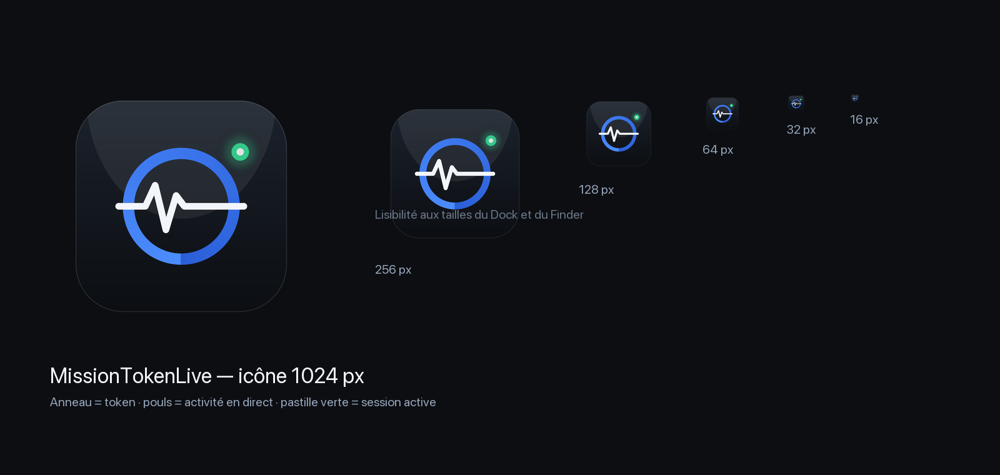

# MissionTokenLive

Cockpit **local-first** pour macOS : voir en direct le travail des agents IA — qui travaille, sur
quelle tâche, avec quel provider et quel modèle, pour combien de tokens et pour quel coût — avec
une étiquette de fiabilité sur chaque chiffre.

SwiftUI · moteur Rust · SQLite · pont C · macOS 14+ · Apple Silicon.



## Ce que l'application affiche

| Écran | Contenu |
|---|---|
| **Maintenant** | Hermès en vedette, agents actifs, timeline, alertes |
| **Agents** | Graphe radial Hermès → sous-agents → outils externes |
| **Tâches** | Liste filtrable + détail (tokens entrée/sortie, coût, erreur) |
| **Coûts & usage** | Jour / semaine / mois, évolution quotidienne, répartitions |
| **Providers** | Cartes API, solde réel ou « Solde non disponible via API », abonnements à part |
| **Logiciels** | Hermès, OpenCode, ChatGPT, Gemini, Antigravity : ouvert / premier plan / arrière-plan / fermé |
| **Projets** | Actifs, archivés, corbeille 30 jours |
| **Flux** | Carte animée : Hermès → logiciels → providers, pulsations = sessions en cours |
| **Cerveau** | Corpus gbrain : faits, sources, entités, derniers faits (lecture seule) |
| **Réglages** | Budget, seuils, providers, confidentialité, widget |

Plus une **pilule de barre de menus** à quatre états (calme, actif, multi-tâches, alerte) avec
panneau au survol. macOS n'autorise pas de Dynamic Island dans l'encoche : c'est un `NSStatusItem`
avec popover.

## Règle non négociable : la fiabilité

Chaque montant porte l'une de ces étiquettes :

- **Réel** — renvoyé tel quel par une API officielle.
- **Calculé** — tokens mesurés × barème versionné et documenté.
- **Estimé** — approximation explicite.
- **Non disponible** — aucune source : on affiche `—`, jamais `0,00 $`.

> Aujourd'hui Hermès expose des tokens réels mais **aucun coût exploitable**
> (`estimated_cost_usd = 0.0`, `cost_source = none`). L'application affiche donc des coûts
> `Calculé` (barème de démonstration, visiblement étiqueté) ou `Non disponible` — jamais un
> montant inventé. Voir `docs/INTEGRATION_AUDIT.md`.

## Installation

### DMG (test rapide)

```bash
./scripts/build.sh && ./scripts/make_dmg.sh
open dist/MissionTokenLive-0.1.0.dmg
```

Glisser l'application dans `Applications`, puis ouvrir. Signature ad-hoc : au premier lancement,
Gatekeeper demande une confirmation (clic droit → **Ouvrir**).

### Depuis les sources

```bash
git clone https://github.com/danyvassily/missiontokenlive.git
cd missiontokenlive
./scripts/build.sh          # moteur Rust + bibliothèque statique + app SwiftUI
open dist/MissionTokenLive.app
```

Prérequis : Xcode Command Line Tools (`swift`, `codesign`), Rust stable (`cargo`), macOS 14+.

Pour lancer en mode démonstration (fixtures) au lieu des données réelles :

```bash
MTL_DEMO=1 ./dist/MissionTokenLive.app/Contents/MacOS/MissionTokenLive
```

Pour capturer un écran précis :

```bash
MTL_SCREEN=agents ./dist/MissionTokenLive.app/Contents/MacOS/MissionTokenLive
```

## Tests

```bash
cargo test                      # domaine, coût, stockage, collecteurs, FFI
./scripts/build.sh              # compilation complète
swift test                      # modèles, décodage du snapshot, fiabilité
```

## Architecture

```
MissionTokenLive/            App/ · Features/ · DesignSystem/ · Models/ · Services/
crates/
  mission-token-core/        domaine, Reliability, moteur de coût
  mission-token-storage/     SQLite, migrations, repositories, corbeille
  mission-token-collectors/  Hermès (mode=ro), OpenCode, présence des logiciels
  mission-token-ffi/         pont C (staticlib) + en-tête public
docs/                        spec, audit d'intégration, confidentialité, limites, roadmap
scripts/build.sh             build reproductible
```

Un seul chemin de données : le moteur Rust produit un **instantané JSON**
(`mtl_snapshot_json`), l'interface Swift le décode et l'affiche. Aucun calcul de coût côté Swift.

### Pont Rust → Swift

```c
char *mtl_version(void);
char *mtl_snapshot_json(const char *db_path);
char *mtl_hermes_tasks_json(uint32_t limit);
char *mtl_desktop_activity_json(void);
int32_t mtl_seed_demo(const char *db_path);
int32_t mtl_project_action(const char *db_path, const char *project_id, const char *action);
void mtl_free_string(char *ptr);
```

Toute chaîne renvoyée par Rust doit être libérée avec `mtl_free_string`. Aucune exception ne
traverse la frontière : les panics sont rattrapés et renvoient `NULL`.

## Connecteurs

| Connecteur | État | Source |
|---|---|---|
| `HermesAdapter` | actif | `~/.hermes/state.db` en lecture seule |
| `OpenCodeAdapter` | actif (compteurs) | `~/.local/share/opencode/opencode.db` |
| `DesktopActivityAdapter` | actif | `NSWorkspace` / processus |
| `OpenRouterAdapter` | prêt, **désactivé** | API de crédits, sur activation explicite |
| `DeepSeekAdapter` | prêt, **désactivé** | API de solde, sur activation explicite |
| `LocalModelAdapter` | actif | coût 0, étiquette `Calculé` |
| `ChatGPTAdapter` / `GeminiAdapter` / `AntigravityAdapter` | présence seule | aucune donnée d'usage lue |

### Ajouter un provider

1. Créer `crates/mission-token-collectors/src/<provider>.rs` implémentant `Collector`.
2. Ajouter une entrée au `PricingTable` **seulement** si le tarif est officiel et vérifié —
   sinon laisser le coût `Non disponible`.
3. Exposer la carte dans `ProvidersView` (données déjà fournies par le snapshot).
4. Ajouter un test qui vérifie que l'absence de solde produit bien `Reliability::Unavailable`.

## Cerveau partagé (gbrain)

L'écran **Cerveau** lit `~/.gbrain/gbrain.sqlite` en lecture seule et montre ce que les agents
savent réellement : nombre de faits atomiques, de chunks, de sources, entités les plus citées,
derniers faits avec leur provenance.

Ce corpus est produit par `~/gbrain` (SQLite FTS5), partagé par Hermès et les harnais de code via
MCP (`gbrain_recall`, `gbrain_remember`). L'application **n'écrit jamais** dans le cerveau et
n'appelle aucune API : elle observe.

```bash
~/gbrain/bin/gbrain ingest        # relit les notes (idempotent)
~/gbrain/bin/gbrain recall "budget mensuel"
curl -s http://127.0.0.1:8760/stats
```

## Confidentialité

Local uniquement : aucune télémétrie, aucun backend, aucun appel réseau par défaut. Les bases
d'Hermès et d'OpenCode sont ouvertes en `SQLITE_OPEN_READ_ONLY`. Aucune conversation, capture
d'écran ou frappe clavier n'est lue. Les clés API vivent dans le Trousseau macOS et ne sont
jamais affichées. Détails : `docs/PRIVACY_AND_LIMITS.md`.

## Limites

Voir `docs/KNOWN_LIMITATIONS.md`. En résumé : pas de Dynamic Island native, coûts réels absents
tant qu'aucun barème validé n'est fourni, application non notarisée, pas d'historique antérieur
au premier lancement.

## Licence

MIT.
